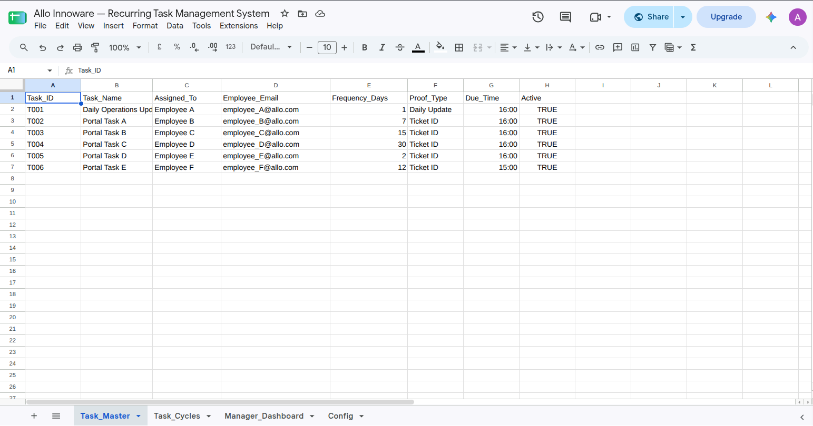
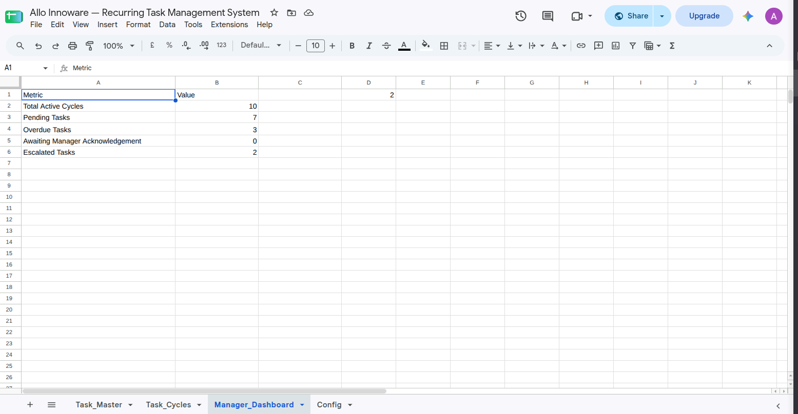
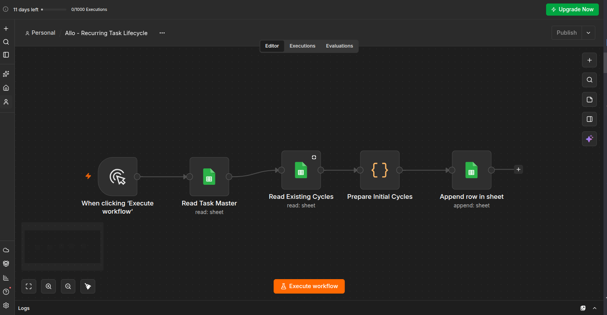
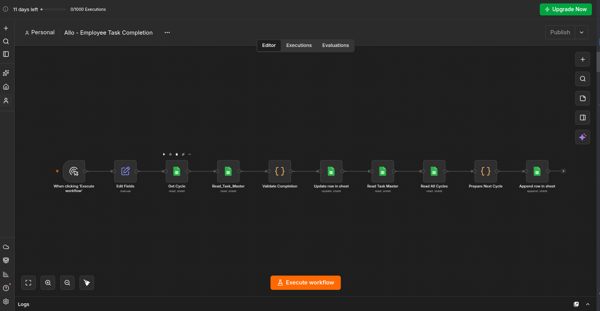
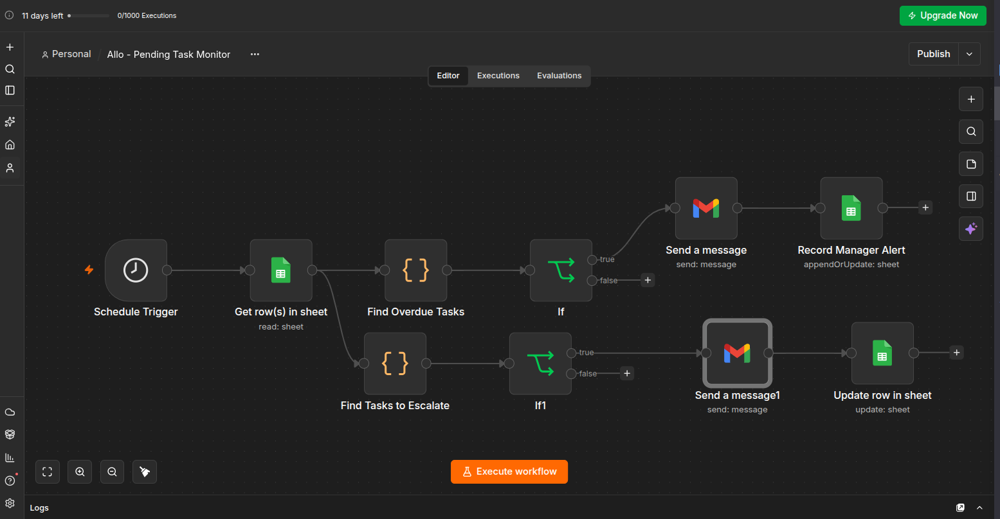
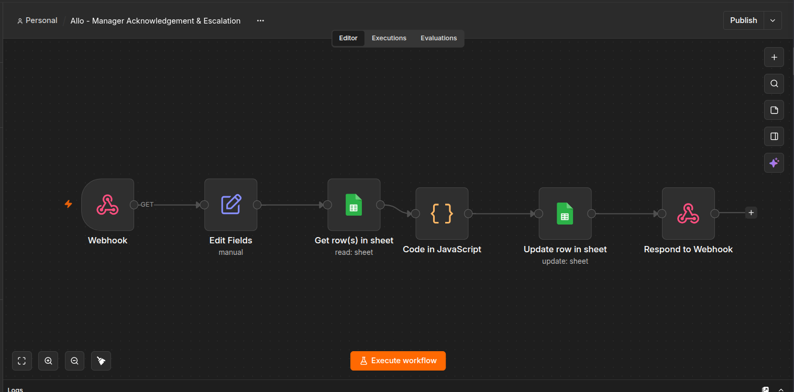
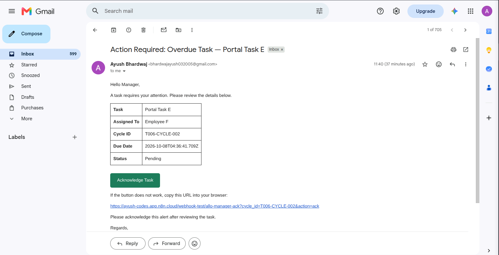

# Workflow Automation Hub

A practical business-process automation project built with **n8n and Google Sheets**. This project demonstrates recurring task tracking, employee completion validation, automated manager notifications, acknowledgement tracking, and SLA-based escalation.

## Overview

Operational teams often manage recurring tasks through spreadsheets, emails, and manual follow-ups. This can lead to missed deadlines, duplicate notifications, and poor visibility into pending work.

Workflow Automation Hub addresses these problems by connecting task records in Google Sheets with automated n8n workflows.

The initial use case focuses on recurring operational task management, with a design that can be extended to other business processes.

## Why n8n and Google Sheets?

I approached this as a **rules-driven business-process automation problem**, rather than an AI-driven decision-making problem.

The requirements are predefined: tasks have recurrence intervals, employees must provide specific evidence, overdue tasks trigger alerts, and unacknowledged alerts can be escalated according to an SLA.

I chose:

- **n8n** for workflow orchestration, validation logic, scheduling, and notifications.
- **Google Sheets** as the primary operating interface and lightweight data store.
- **Gmail** for manager alerts and leadership escalation emails.

An LLM integration was not necessary for the core requirements. Deterministic rules are more appropriate for checking task status, validating required fields, comparing timestamps, and preventing duplicate notifications. An LLM could be introduced later for optional features such as summarizing unstructured reports or answering natural-language queries.

## Architecture

```text
                 Google Sheets
                  Task_Master
                      |
                      v
           1. Recurring Task Lifecycle
             Creates initial task cycles
                      |
                      v
                  Task_Cycles
                      ^
                      |
           2. Employee Task Completion
           Validates employee and evidence
           Records completion and next cycle
                      |
                      v
           3. Pending Task Monitor
           Detects overdue tasks
           Sends manager alerts
           Escalates eligible tasks
                      |
                      v
           4. Manager Acknowledgement
           Receives acknowledgement request
           Records acknowledgement timestamp
                      |
                      v
               Manager Dashboard
```

## Workflow Details

### 1. Recurring Task Lifecycle

- Reads active task definitions from `Task_Master`.
- Uses the configured recurrence frequency.
- Checks existing cycle IDs before creating a new initial cycle.
- Creates a pending task occurrence in `Task_Cycles`.
- Prevents duplicate initial-cycle creation when the workflow is rerun.

### 2. Employee Task Completion

- Accepts a task cycle ID, employee email, Ticket ID, and proof/update.
- Finds the corresponding task cycle and task definition.
- Validates the submitted email against the task's configured employee email.
- Checks the required proof or Ticket ID.
- Rejects invalid submissions and attempts to complete an already completed cycle.
- Records the completion status, timestamp, and employee email.
- Creates the next recurring cycle after successful completion.

### 3. Pending Task Monitor

- Checks task cycles for overdue pending work.
- Sends a manager email after the configured alert delay.
- Records `Last_Manager_Alert_At` to prevent repeated manager alerts.
- Checks whether an unacknowledged task has passed the acknowledgement window.
- Sends an escalation email and records `Escalated_At` when the escalation conditions are met.

### 4. Manager Acknowledgement

- Receives a webhook request containing the cycle ID and acknowledgement action.
- Validates the relevant task cycle and whether acknowledgement is permitted.
- Records `Manager_Acknowledged_At` in Google Sheets.
- Allows the pending-task monitor to exclude acknowledged tasks from its acknowledgement-based escalation branch.

The manager email includes a dynamic acknowledgement link for the corresponding task cycle.

## Google Sheets Structure

| Sheet | Purpose |
|---|---|
| `Task_Master` | Task definitions, assignees, employee emails, recurrence frequency, proof requirements, due time, and active status |
| `Task_Cycles` | Individual task occurrences, status, evidence, completion timestamps, manager alerts, acknowledgements, and escalations |
| `Manager_Dashboard` | Summary metrics for total cycles, pending tasks, overdue tasks, pending acknowledgements, and escalated tasks |
| `Config` | Configuration values for manager and leadership contacts and SLA settings |

Each task occurrence has a unique `Cycle_ID`, allowing the system to track recurring instances separately.

## SLA and Escalation

The current demonstration logic uses the following thresholds:

- **Manager alert delay:** 30 minutes after a task becomes overdue.
- **Acknowledgement window:** 2 hours after the manager alert timestamp.
- **Duplicate prevention:** Existing alert and escalation timestamps prevent repeat notifications for the same cycle.

See [`docs/sla-and-escalation.md`](docs/sla-and-escalation.md) for details and implementation caveats.

## Testing

The prototype has been tested for:

- Valid task completion.
- Missing daily proof or update.
- Missing portal Ticket ID.
- Unauthorized employee submissions.
- Duplicate completion attempts.
- Recurring-cycle creation.
- Manager alerts and duplicate-alert prevention.
- Manager acknowledgement through the email link.
- Leadership escalation for eligible unacknowledged tasks.

See [`docs/test-cases.md`](docs/test-cases.md) for the test matrix and observed results.

## Screenshots

The `screenshots/` directory contains the workflow canvases and demonstration evidence.

### Task Manager



### Manager Dashboard



### Recurring Task Lifecycle



### Employee Task Completion



### Pending Task Monitor



### Manager Acknowledgement



### Manager Alert Email



## Setup and Demonstration

1. Create the Google Sheets structure described above.
2. Configure Google Sheets and Gmail credentials in n8n.
3. Add task definitions and valid employee email addresses.
4. Configure manager and leadership recipients.
5. Create or import the four workflows and verify their node mappings.
6. Test with dummy data before using real employee records.
7. Start the acknowledgement webhook's test listener before clicking the demonstration acknowledgement link.

The current acknowledgement email uses an n8n test webhook, which is temporary and requires the listener to be running.

## Known Limitations

- The acknowledgement link currently uses an n8n test webhook rather than a persistent production endpoint.
- The demonstration webhook does not authenticate the manager and must be secured before production use.
- Some SLA thresholds are hardcoded in Code nodes rather than read dynamically from `Config`.
- The `Config` sheet contains a 24-hour escalation setting, but the current escalation code uses the 2-hour acknowledgement window.
- Due-date timezone handling should be standardized to the business timezone before production deployment.
- The prototype uses demonstration employee and task data; all addresses and permissions must be verified before real use.
- Google Sheets is appropriate for a lightweight prototype, but production deployment should consider concurrency, access controls, audit retention, and error handling.

## Future Improvements

- Production webhook deployment with manager authentication.
- Fully configurable SLA policies.
- Consistent timezone-aware due-date calculations.
- Automated regression testing and error notifications.
- An employee-facing task submission interface.
- Additional reusable workflows for approvals, reporting, and operations.

## Author

**Ayush Bhardwaj**

- GitHub: [bhardwaj-ayush03](https://github.com/bhardwaj-ayush03)
- LinkedIn: [ayushbhardwaj03](https://linkedin.com/in/ayushbhardwaj03)
